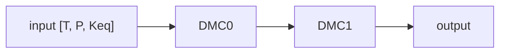
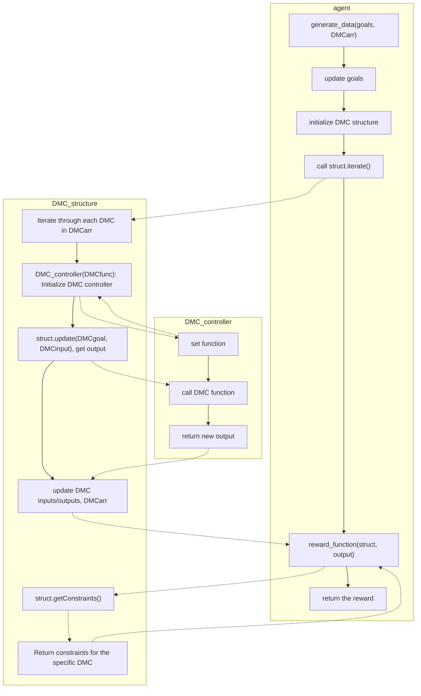

# DMC structure
This document outlines the past, most complete simulation structure. 

At the time of writing, this is what was done during the semester. 

## Explanation of DMC_controller, DMC_structure, and data generation.
A major component of the model is the data generation and simulation. Because all the data is generated, it is crucial to create is accurately. The two main classes are DMC_controller and DMC_structure.

As a reminder, the agent only has access to the input and output of the DMC (temperature, pressure, Keq), as well as the constraints of the DMC. Any functions within the DMC are a "black box". This black box is represented by DMC_controller.

### DMC_controller
This is a generic class that defines a given DMC. The only initialization needed for a given DMC is the function name. It is very important to know that the agent does not have direct access to any of the functions in this class to preserve the notion that the DMC internals are a black box. The functions included in this class are as follows:

* **_DMC1(Tcurr, Tset), _DMC2(Tcurr, Tset)**: These are the functions that return the next temperature, pressure, and Keq based on the input temperature. The current function only requires input temperature, but a DMC can easily use more input parameters with the current function construction.

    DMCs currently have a maximum temperature change that they can achieve per time step. This is for two main reasons. First, it is unrealistic to assume that a DMC can instantaneously achieve the goal temperature. Second, if the simulated DMCs do instantaneously achieve the goal temperature, then each DMC will be "perfect" all the time, rendering the agent useless. As such, we cap the change to one tenth of the difference of the goal and current temperature. Because we also introduced randomness to the outputs (by 5 degrees), we do not cap the temperature change within 5 degrees. This prevents random walk behavior.

* **DMC1constraints(), DMC2constraints()**: These return the constraints of the DMC. This was included in DMC_controller because all DMC information is contained in this class.

* **getConstraints()**: A simple getter that returns the constraints of the DMC. Because the DMC type is defined at initialization (via function name), it will return the correct constraints based on the initalized type.

* **update(goal, inputList)**: calls either _DMC1 or _DMC2 based on the type

### DMC_structure
This is what contains the iteration functionality as well as getters/setters for the goal and constraints. It is initialized via an array of DMCs, which is explained in the next section. Functions include:

* **setGoal(DMCnumber, newGoal)**: Set the goal of a given DMC. The goal for the current DMC setup is simply the Keq, but can be modified to be different later.
* **getConstraints()(DMCnumber)**: Get the constraints as well as the output for a given DMC. The current output is:
    ```
    [
        [currentTemperature, [lowerTemperatureBound, upperTemperatureBound]],
        [currentPressure, [lowerPressureBound, upperPressureBound]],
        [currentKeq, [lowerKeqBound, upperKeqBound]]
    ]
    ```
* **iterate()**: This is what the agent uses to update a DMC for a single time step. For each DMC, it first gets the appropriate DMC_controller. It calls update based on the goal and input, and then it updates the appropriate outputs. The current assumption is that each DMC only has one input. Later models will be able to support multi-DMC inputs.
### DMC chain
Each DMC in the DMC array is initialized as:
```
[index (DMC ID), connected DMCs, DMC function type, goal, input array (temperature, pressure, Keq)]
```
It is important to note the following points:

The first DMC accepts itself as an input. The current model has a static input stream (temperature, pressure, Keq are constant). With the way that the DMC functions are designed, the first DMC needs to be able to "remember" what its adjusted temperature is, otherwise the temperature cap may interfere with the agent.

The final value in the array is the input to the DMC. For example, for [0, [0, 1], "DMC1", 400, [350, 5, 1]], the input for DMC0 at the next time step is [350, 5, 1]. This allows us to update the DMC in iterate() in linear time. For very computationally intensive agents, this is a critical design decision.
Visualization of chain (excluding the self-loop for DMC 0):

Note: If the visualization doesn't show, then you can preview mermaid graphs at the following link: https://mermaid.live/ The visualizations are simply an aid to the other explanations in this section. The easiest is to download the Markdown Preview Mermaid Support extension in VSCode

Visualization of information flow
Below is a visualization of the information flow for the DMCs and agent. It covers everything mentioned above, in a graphical format.
