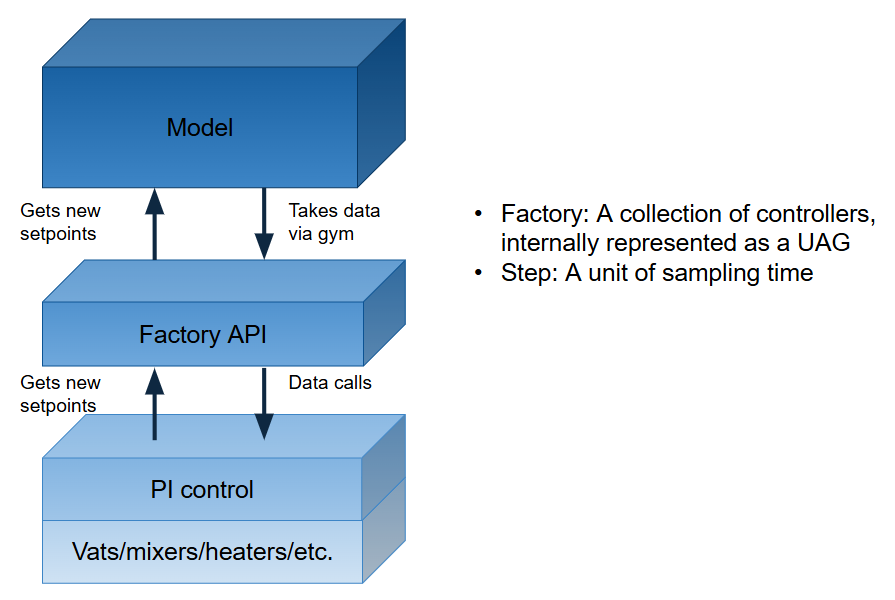

# Three primary layers

The architecture features three main layers:
* **model**: AI model that attempts to control the factory
* **API**: interface for the model to interact with the simulation
* **simulation**: internal model of a factory

